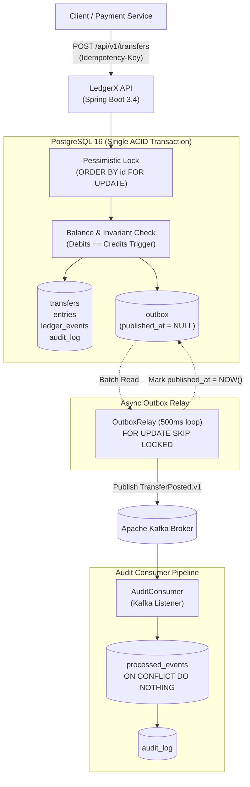

# LedgerX

Production-grade double-entry financial ledger API featuring transactional outbox, deterministic locking, append-only event logging, exactly-once consumer deduplication, and automated balance reconciliation.

[](https://ledgerx.fly.dev/swagger-ui.html)
[](https://adoptium.net)
[](https://spring.io/projects/spring-boot)
[](https://www.postgresql.org)
[](https://kafka.apache.org)

---

## Architecture Overview



---

## Live Demo & Interactive Documentation

- **Live Interactive Swagger UI:** [https://ledgerx.fly.dev/swagger-ui.html](https://ledgerx.fly.dev/swagger-ui.html)
- **Actuator Health Endpoint:** [https://ledgerx.fly.dev/actuator/health](https://ledgerx.fly.dev/actuator/health)
- **Prometheus Metrics:** [https://ledgerx.fly.dev/actuator/prometheus](https://ledgerx.fly.dev/actuator/prometheus)
- **2-Minute Demo Recording Script:** [docs/demo-script.md](docs/demo-script.md)
- **Technical Deep-Dive Blog:** [docs/blog-outbox-pattern.md](docs/blog-outbox-pattern.md)

---

## Trade-offs & Design Decisions

### 1. Money Representation: `long` Minor Units vs. `BigDecimal`
- **Decision:** Money is strictly modeled as `long` minor units (e.g., cents, pence) paired with ISO-4217 currency codes (`CHAR(3)`). Floating point types (`float`, `double`) and `BigDecimal` are banned from financial mutation paths.
- **Trade-off:** Eliminates binary floating-point rounding errors and heap allocation overhead in high-throughput hot paths, while enforcing explicit fractional precision rules.

### 2. Concurrency: Deterministic Pessimistic Locking vs. Optimistic Retry
- **Decision:** Account rows are locked using `lockByIdsOrdered` (`ORDER BY id FOR UPDATE`).
- **Trade-off:** Under high concurrency opposing transfers ($A \rightarrow B$ and $B \rightarrow A$), optimistic locking suffers from high rollback and retry storm rates. Deterministic lock ordering mathematically guarantees zero deadlocks at the cost of short serialized lock hold times per account.

### 3. Messaging: Transactional Outbox vs. Direct Kafka Publish
- **Decision:** Kafka is never called inside the transfer transaction. Events are written to the PostgreSQL `outbox` table within the payment transaction, and drained by an asynchronous `OutboxRelay` using `FOR UPDATE SKIP LOCKED`.
- **Trade-off:** Introduces a ~500ms asynchronous propagation delay, but completely eliminates the dual-write problem. Customer transfers succeed with HTTP 201 even during catastrophic Kafka broker outages.

---

## Delivery Guarantees

- **Publishing (At-Least-Once):** The transactional outbox pattern guarantees at-least-once publishing to Apache Kafka. Kafka is never called inside the transfer transaction. If the relay encounters network timeouts or broker partitions during delivery acknowledgment, it retries with durable exponential backoff, which may produce duplicate published messages.
- **Consumption (Exactly-Once Effect):** Downstream consumers achieve an end-to-end exactly-once processing effect by recording handled message identifiers in the `processed_events` table (`ON CONFLICT (event_id, consumer_group) DO NOTHING`) within their local database transaction before executing any side effects.

### 4. Resilience: Durable Exponential Backoff in SQL
- **Decision:** Outbox retry state (`attempts`, `last_error`, `next_attempt_at`) is maintained directly in PostgreSQL (`V8__outbox_next_attempt_at.sql`). Delay expands as $\min(300, \text{attempts}^2)$ seconds.
- **Trade-off:** Offloads retry state persistence to PostgreSQL rather than an external memory store (e.g. Redis), preserving zero external dependency overhead.

---

## Known Limitations

1. **No External Authentication / OAuth:** Multi-tenancy is scoped via `X-Tenant-Id` header validation against database records. Production deployment would integrate an API gateway (e.g., Kong, Ory, or AWS API Gateway) for JWT/mTLS termination.
2. **Single Currency Transfers:** Each transfer operates within a single currency boundary (e.g. USD $\rightarrow$ USD). Multi-currency transactions and real-time FX conversions are deferred to Project 2.
3. **No Automatic Reversals:** Payment corrections require explicit compensating transfers rather than `DELETE` or `UPDATE` mutations, preserving double-entry audit purity.
4. **Headless Engine (No Frontend UI):** LedgerX is an API-first core engine. Interactive inspection is handled via Swagger UI and Prometheus/Grafana dashboards.

---

## Core API Endpoints

All endpoints reside under `/api/v1` and return standardized JSON contracts:

### Post Transfer
`POST /api/v1/transfers`
- Headers: `Idempotency-Key: <uuid>`, `X-Tenant-Id: <tenant-uuid>`
- Request Body:
  ```json
  {
    "fromAccountId": "11111111-1111-1111-1111-111111111111",
    "toAccountId": "22222222-2222-2222-2222-222222222222",
    "amountMinor": 25000,
    "currency": "USD",
    "description": "Merchant invoice settlement"
  }
  ```
- Responses: `201 Created` (new transfer), `200 OK` (idempotent replay), `409 Conflict` (key collision with altered payload), `422 Unprocessable Entity` (insufficient funds).

### Audit Trail
`GET /api/v1/audit?entityType=TRANSFER&limit=50`
- Cursor-based pagination using base64 tokens (`?cursor=...`).

### Admin Balance Reconciliation
`POST /api/v1/admin/reconcile`
- Scans all accounts, verifies `accounts.balance_minor == sum(entries)`, logs mismatch audit records, and updates the `ledgerx.reconcile.mismatches` gauge.

---

## Local Development & Quickstart

```bash
# 1. Start Docker dependencies (PostgreSQL 16, Kafka KRaft, Prometheus, Grafana)
cd docker
docker compose up -d
cd ..

# 2. Run the application locally
./mvnw spring-boot:run -Dspring-boot.run.profiles=local

# 3. Verify health & endpoints
curl -s http://localhost:8080/actuator/health
```

---

## Verification & Testing Suite

```bash
# Run unit tests (17 passed)
./mvnw test

# Run full integration test suite with Testcontainers
./mvnw -B verify
```

| Test Class | Focus Area |
|---|---|
| `TransferApiIT` | Double-entry transaction creation, funds validation, balance trigger enforcement |
| `IdempotencyIT` | Exact-match idempotency replay and payload tampering conflict detection |
| `ConcurrencyIT` | 100 parallel cross-account transfers verifying zero deadlocks and balance invariant |
| `OutboxRelayIT` | Kafka broker downtime simulation, durable exponential backoff, and recovery |
| `ConsumerDedupeIT` | Duplicate Kafka message suppression via `processed_events` table |
| `ReconciliationIT` | Intentional balance corruption detection and mismatch alerting |
| `ObservabilityIT` | Verification of Prometheus `/actuator/prometheus` metrics and `X-Request-Id` correlation |
| `TransferInvariantsIT`| Property-based testing (jqwik) verifying double-entry invariants over random transfer sequences |

---

## Observability & Dashboards

- **Metrics:** Emits `ledgerx.transfer.posted`, `ledgerx.transfer.failed`, `ledgerx.outbox.pending`, `ledgerx.outbox.published`, `ledgerx.reconcile.mismatches`, and latency timers.
- **Grafana Dashboard:** Pre-configured Grafana dashboard JSON (Spring Boot 3 ID 19004 + 3 custom LedgerX panels) available at [`docs/grafana-dashboard.json`](docs/grafana-dashboard.json).
