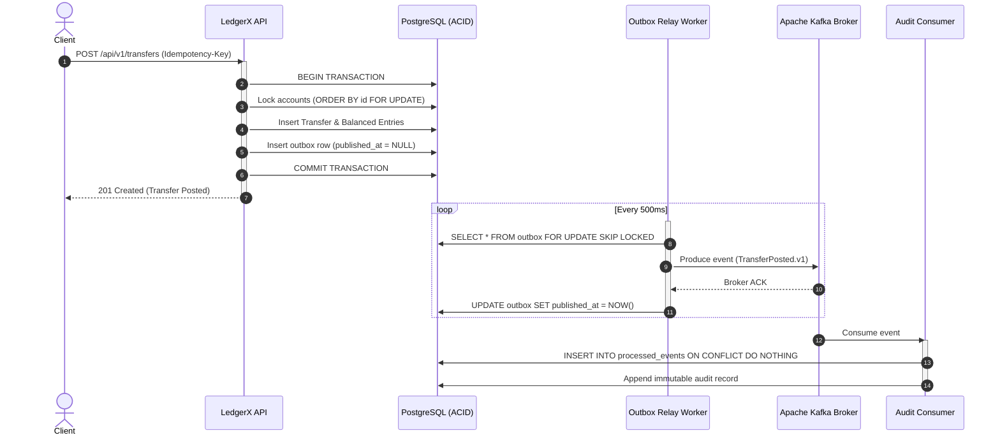

# How I Built Exactly-Once Payments with the Transactional Outbox Pattern

*By Akinmoladun Damilare — Solo Builder of LedgerX*

When building a core financial ledger, the single most dangerous line of code you can write looks completely harmless:

```java
@Transactional
public TransferResponse postTransfer(TransferRequest request) {
    // 1. Update balances & create ledger entries in Postgres
    updateBalances(request);
    createLedgerEntries(request);

    // 2. Publish event to Kafka
    kafkaTemplate.send("transfers.posted", new TransferEvent(request)); // ❌ DISASTER
    
    return response;
}
```

It looks clean. It passes unit tests. And in production, it will inevitably corrupt your financial system.

Here is the story of how I encountered the classic **Dual-Write Problem** while designing [LedgerX](https://github.com/Akinmoldun/LedgerX) — a double-entry ledger engine — and how implementing the **Transactional Outbox Pattern** gave me verifiable, crash-resilient exactly-once semantics.

---

## The Dual-Write Trap

In a distributed financial system, you need two things to happen when money moves:
1. Mutate state in PostgreSQL (balances, immutable journal entries, audit log).
2. Broadcast an event to Apache Kafka so downstream notification services, fraud analysis, and data warehouses react.

The fatal trap is that **PostgreSQL transactions and Kafka publishes cannot share an atomic ACID transaction**.

Consider the failure modes:
- **Scenario A:** The Kafka broker hangs or throws a network timeout. The `@Transactional` block catches the exception and rolls back the database. But what if Kafka actually received the bytes right before the network dropped? Your event was published, but the money never moved.
- **Scenario B:** You publish to Kafka at the end of the method. The Kafka send succeeds, but when Hibernate issues the final `COMMIT` to PostgreSQL, a database constraint fails or the connection drops. You just broadcasted a payment that does not exist in the ledger.
- **Scenario C:** Kafka is temporarily down for maintenance. Your entire payment API returns HTTP 500, rejecting transfers even though your database is completely healthy.

Never call a message broker inside an open database transaction.

---

## The Solution: The Transactional Outbox Pattern

The Transactional Outbox Pattern decouples your database commit from message delivery by storing the message directly inside PostgreSQL as an append-only table.

Because the outbox row is written inside the **same database transaction** as the financial transfers and ledger entries, it is protected by the database's ACID guarantees. Either everything commits together, or nothing does.



---

## 3 Critical Engineering Decisions in LedgerX

Implementing the pattern in production requires more than a naive table and polling loop. Here are three architectural choices that made LedgerX bulletproof:

### 1. Concurrency with `FOR UPDATE SKIP LOCKED`
If you run multiple instances of your application, multiple outbox pollers will fight over the same pending rows. 

Instead of external distributed locks (like Redis/Redlock), LedgerX uses PostgreSQL's native row locking:

```sql
SELECT * FROM outbox
WHERE published_at IS NULL
  AND next_attempt_at <= NOW()
ORDER BY created_at ASC
LIMIT 50
FOR UPDATE SKIP LOCKED;
```

`SKIP LOCKED` allows instance A to lock rows 1–50 while instance B concurrently processes rows 51–100 without blocking or waiting.

### 2. Durable Exponential Backoff in SQL
If Kafka goes down, an unconstrained relay will spin in a tight CPU loop, flooding logs with connection errors.

LedgerX stores retry metadata directly in the `outbox` table (`V8__outbox_next_attempt_at.sql`):
```sql
ALTER TABLE outbox 
  ADD COLUMN attempts INT NOT NULL DEFAULT 0,
  ADD COLUMN last_error TEXT,
  ADD COLUMN next_attempt_at TIMESTAMPTZ NOT NULL DEFAULT NOW();
```

When a publish fails, the delay expands exponentially: $\text{delay} = \min(300, \text{attempts}^2)$ seconds. The poller query simply excludes rows where `next_attempt_at > NOW()`, letting failing rows rest while fresh transactions continue flowing.

### 3. Idempotent Consumer Deduplication
The Outbox pattern guarantees **at-least-once delivery**. Network partitions during the ACK phase can cause a message to be published twice.

To achieve end-to-end **exactly-once semantics**, the consumer tracks processed message IDs using an atomic deduplication table:

```sql
INSERT INTO processed_events (event_id, consumer_group, processed_at)
VALUES (?, 'audit-consumer', NOW())
ON CONFLICT (event_id, consumer_group) DO NOTHING;
```

If the row already exists, the consumer immediately ACKs Kafka and skips side effects.

---

## Conclusion

By moving event publication out of the HTTP transaction and into a durable database-backed outbox:
- Payment requests succeed even when Kafka is completely offline.
- Data never goes out of sync between PostgreSQL and event streams.
- The system achieves ironclad consistency without complex distributed transaction protocols.

You can inspect the full Java 21 implementation, Flyway migrations, and Testcontainers test suite on GitHub: [github.com/Akinmoldun/LedgerX](https://github.com/Akinmoldun/LedgerX).
